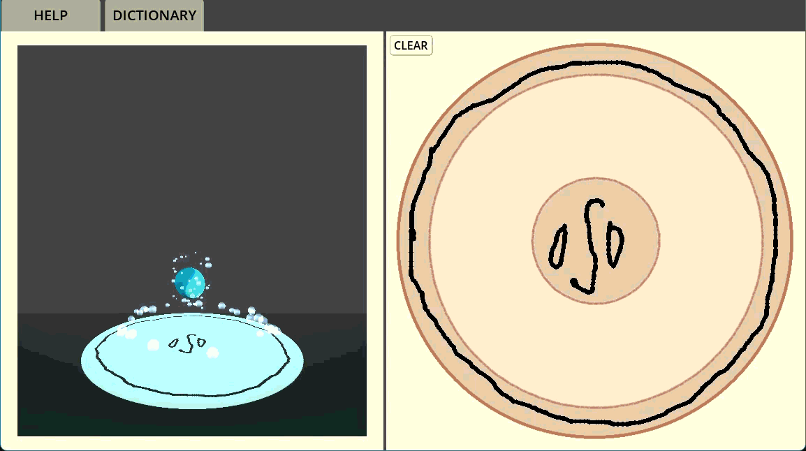

# AtelierMagic
A game simulator for the "Witch Hat Atelier" magic system.

# Installation
The entire simulation is self contained. All needed is to install the zip file and run the program
*Currently available only for windows*

# Versions
## v0.1
Initial Release. Basic Elemental Glyphs and Keystone Spells. A simple but exhaustive pattern-matching for spell classification.

# Reference
Ofcourse, the anime *Witch Hat Atelier*

[Witch Hat Atelier Fandom](https://witch-hat-atelier.fandom.com/wiki/Magic)

And definitely inspired by [Nerva dof's](https://youtu.be/zVWYW0K3ikg) implementation of the magic system, definitely check out his channel!

## Legal & Disclaimer

*AtelierMagic* is an unofficial, non-commercial fan-made project inspired by the magic system concepts present in *Witch Hat Atelier* (Japanese: とんがり帽子のアトリエ, Hepburn: Tongari Bōshi no Atorie), created by Kamome Shirahama and published by Kodansha. 

All source code, algorithms, and software logic in this repository are distributed under the MIT License. All original character concepts, world-building, trademarked terms, and official visual artwork remain the intellectual property of Kamome Shirahama and Kodansha.
